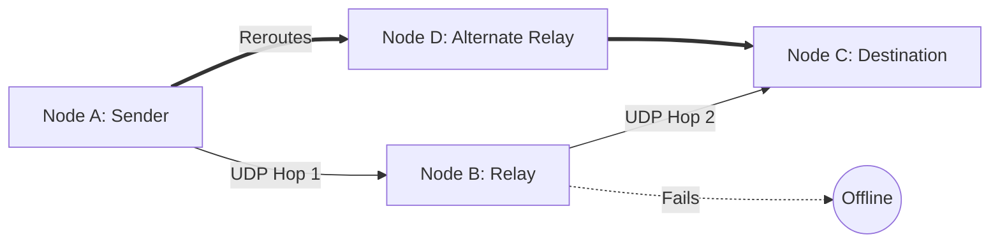
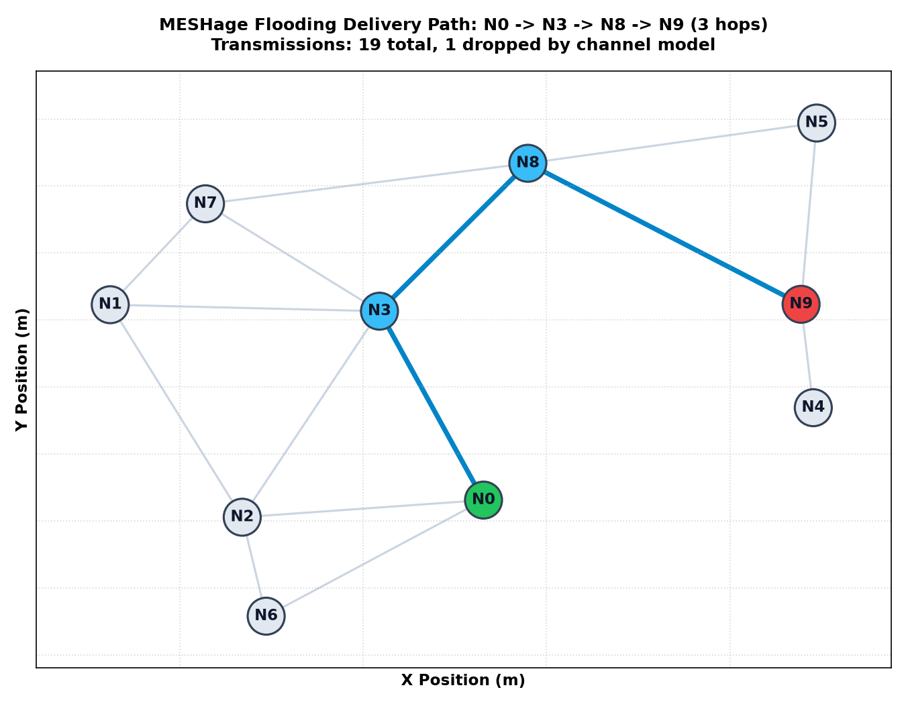
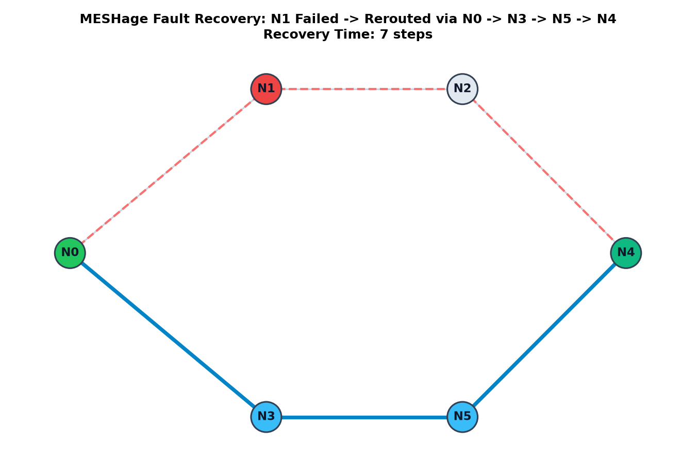

# MESHage

An offline peer-to-peer mesh messaging system that routes encrypted messages across local devices without cellular or internet connectivity.


## Overview
Centralized messaging services stop working during network blackouts, natural disasters, and in remote locations without cellular coverage. MESHage enables text communication across mobile and desktop devices by turning each device into an autonomous wireless relay node. Messages hop peer-to-peer over local Wi-Fi UDP sockets across dynamically discovered routes. It operates without internet access, central servers, or SIM cards.

## Features
- **Peer-to-Peer Messaging:** Send direct text messages to discovered nodes across multi-hop paths.
- **Broadcast Alerts:** Broadcast messages across the entire reachable mesh.
- **Emergency SOS:** Trigger high-priority emergency alerts via 1.5-second press-and-hold.
- **Dynamic Routing:** Route packets using Dijkstra shortest-path, bounded flooding, or gossip routing.
- **Self-Healing Topology:** Detect link failures via hello packet timeouts and automatically reroute traffic.
- **Authenticated Encryption:** Protect message confidentiality and tamper integrity with AES-256-GCM.
- **Interactive Radar Simulation:** Visualize 30-node mesh topologies and link degradation in real time on an HTML5 canvas.

## Tech Stack

| Layer | Technology |
|---|---|
| Core Language | Python 3 |
| Transport & Networking | UDP Sockets (`socket`), Server-Sent Events (SSE) |
| Web API & UI Server | Flask |
| Frontend | Vanilla HTML5, CSS3, JavaScript (Offline PWA) |
| Security | `cryptography` (AES-256-GCM, Nonces, Replay Windows) |
| Simulation & Modeling | NumPy, Matplotlib (Log-distance path loss, log-normal shadowing) |

## How It Works

Nodes exchange periodic 1-hop UDP "Hello" packets on port 5001 to advertise active neighbors and link costs. Each node maintains a link-state table and computes forwarding paths using Dijkstra's algorithm. When an intermediate node goes silent, missed hellos trigger dynamic route recalculation around the failure.



## Screenshots

| Multi-Hop Route Propagation | Self-Healing Reroute on Failure |
|---|---|
|  |  |

## Running It Locally

### Prerequisites
- Python 3.9+
- Pip dependencies: `flask`, `cryptography`, `matplotlib`, `numpy`

### 1. Install Dependencies
```bash
pip install flask cryptography matplotlib numpy
```

### 2. Run Local 3-Node Test
Starts nodes A, B, and C in a chain on local ports:
```bash
python scripts/run_local_test.py
```

### 3. Run a Live Mesh Node with Web UI
```bash
python node/mesh_node.py --name A --port 5001 --api-port 5000
```
Open `http://localhost:5000` in your browser.

### 4. Run the Visual Simulation Radar
```bash
python sim/server.py
```
Open `http://localhost:5000/dashboard` in your browser.

## Testing

Run the test suite using Python's standard `unittest`:
```bash
python -m unittest discover -s tests -p "test_*.py"
```

The 19 automated unit tests cover:
- **Router Logic (`test_router.py`):** Unicast routing, broadcast flooding, Dijkstra shortest path, loop prevention, TTL expiration, deduplication caching, and hello timeout self-healing.
- **Cryptography (`test_crypto.py`):** AES-256-GCM authenticated encryption, decryption validation, tampered message rejection, replay attack mitigation, and relay privacy.
- **API (`test_api.py`):** REST endpoint responses and node state serialization.

## License
MIT
